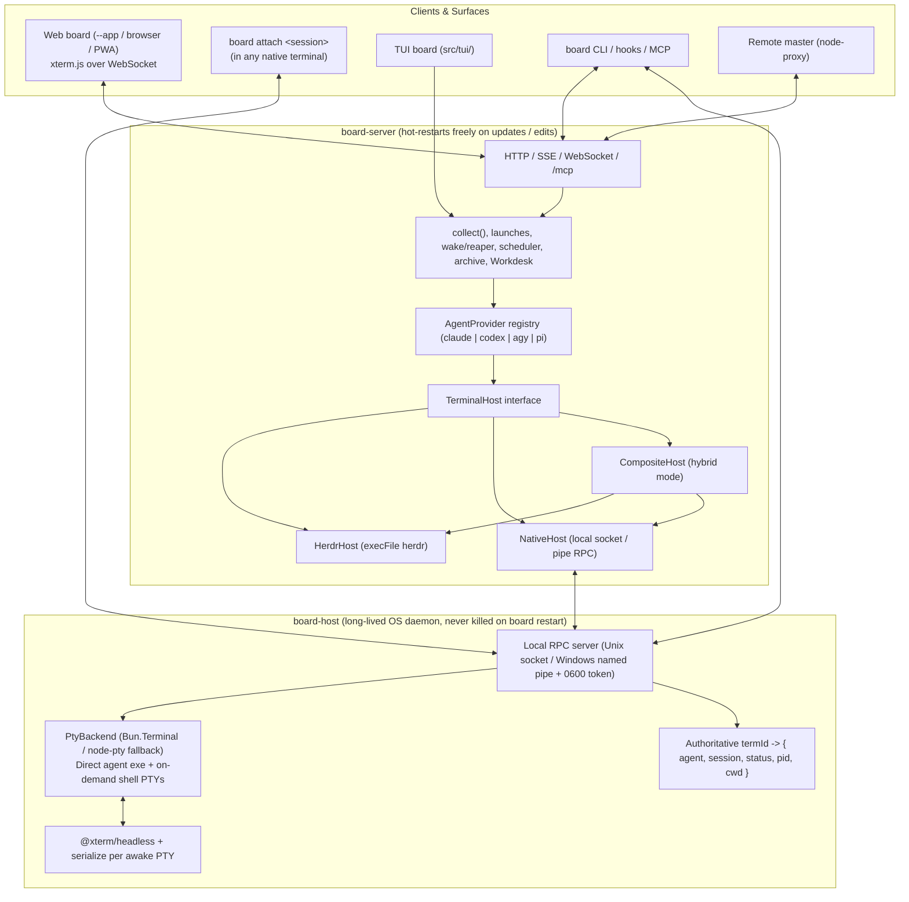

# Board-owned terminals: running sessions without herdr

Design draft for [#889](https://github.com/MokuTeam/herdr-agent-board/issues/889) (discussion draft, no code built yet; shared with a hub teammate; the owner decides). Grounded against `main` at `4e3cc3af`. Names in examples (`atlas`, `laptop`, `server-1`, `server-2`) are made up.

## Contents

1. [The problem, the goal, and the honest trade-off](#1-the-problem-the-goal-and-the-honest-trade-off)
2. [Memory and resource numbers](#2-memory-and-resource-numbers)
3. [What the code uses herdr for today](#3-what-the-code-uses-herdr-for-today)
4. [Architecture: two processes, two clean abstractions](#4-architecture-two-processes-two-clean-abstractions)
5. [Pseudo-terminal layer: options compared and direct execution](#5-pseudo-terminal-layer-options-compared-and-direct-execution)
6. [Provider-agnostic agent interface (`AgentProvider`)](#6-provider-agnostic-agent-interface-agentprovider)
7. [Sleep, wake, and lifecycle without shells](#7-sleep-wake-and-lifecycle-without-shells)
8. [Answering everything herdr gives today](#8-answering-everything-herdr-gives-today)
9. [Phased rollout and per-machine switch](#9-phased-rollout-and-per-machine-switch)
10. [Risks and mitigations](#10-risks-and-mitigations)
11. [What stays herdr-only](#11-what-stays-herdr-only)
12. [Open questions for the owner](#12-open-questions-for-the-owner)

---

## 1. The problem, the goal, and the honest trade-off

Today the board runs as a plugin inside `herdr` (`herdr-plugin.toml`). Every runtime call shells out via `execFile` to `HERDR_BIN_PATH || 'herdr'` (`src/adapters/herdr.ts:12,87-118`). Every agent session sits inside an interactive shell pane (`pwsh.exe` on Windows, `bash`/`zsh` on Linux and macOS) often accompanied by a `herdr-sidebar` pane. This creates four structural costs:

1. **Windows memory tax (#204, #243, #888):** Interactive `pwsh.exe` shells (~30–75 MB each), `OpenConsole.exe` / `conhost.exe` pairs, and `herdr-sidebar.exe` panes linger across sleeps, leaks, and reboots — repeatedly reaching **1.5–3.4 GB** of pure shell/console overhead on the owner's Windows laptop.
2. **Headless node weight:** Remote nodes (`src/core/node-plan.ts`, `src/core/node-oneshot.ts`) must install and supervise `herdr server` just to hold agent PTYs, even though nobody ever attaches a GUI window on a VPS.
3. **Web terminal polling:** Because `herdr` exposes no PTY output stream, `src/services/terminals.ts:472-531` polls `herdr pane read` every 120 ms–1 s, runs `herdr pane layout` every 10 s, never resizes the underlying PTY, guesses cursor coordinates (`caretSpot`), and sends input via `herdr pane send-text` argv.
4. **Fragile screen-scraping and ID reuse:** Launch, naming, sleep, wake, and dialogs must parse shell prompts (`atPrompt`), clear shell lines (`Esc` vs `Ctrl+U`), guard against `herdr` reusing `pane_id`s across restarts (`src/adapters/profile-panes.ts`, `terminals.ts:257-268`, `services/move-out.ts:269-293`), and skip `herdr-sidebar` "furniture" when closing tabs.

**The goal:** Give the board its own pseudo-terminal host (`board-host`) running each agent executable **directly with no shell in between**. **Sleep = stop the process** (0 MB, 0 processes). **Wake = start a fresh PTY with `--resume`** (or the provider's equivalent). Put both `herdr` and `board-host` behind a clean `TerminalHost` interface, and unify `claude`, `codex`, `agy`, and `pi` behind a provider-agnostic `AgentProvider` contract so every existing board feature works identically across hosts and agents.

### Honest comparison up front: Path A (#888) vs Path B (this design)

Before committing engineering time, compare this design (**Path B**) against the smaller fix already scoped in companion issue [#888](https://github.com/MokuTeam/herdr-agent-board/issues/888) (**Path A**):

| Dimension | Path A: Stay on `herdr` + fix #888 (direct-command panes) | Path B: Board-owned PTY host (`board-host`) |
|---|---|---|
| **Windows RAM savings** | Recovers ~1.7–2.0 GB immediately by fixing empty-shell leaks and starting agents without `pwsh.exe` in between (`pane run` direct exe + `tab close` on sleep). | Recovers ~1.8–2.1 GB (0 MB per sleeper), minus ~50–80 MB base for `board-host` + ~2–5 MB per awake headless VT buffer. |
| **Engineering & risk** | Small, localized changes to `wake`/`spawn-agent`/`archive`/`move-out`; zero new ConPTY surface. | Large multi-phase build; board permanently owns cross-platform PTYs, Windows ConPTY quirks, headless VT emulation, and OS daemon units. |
| **Linux / macOS RAM** | Saves ~5 MB per shell (negligible). | Roughly neutral (saves ~5 MB/shell, adds ~60 MB `board-host` base). |
| **Headless VPS nodes** | Still requires installing and running `herdr >= 0.9.5` + `herdr.service`. | Zero `herdr` dependency; nodes need only Bun + git + agent CLIs. |
| **Web terminal UX** | Remains `pane read` polling (120 ms–1 s), no real PTY resize, no native cursor, `send-text` argv. | Real WebSocket + `@xterm/xterm` stream, true PTY resize, real cursor, stdin writes. |
| **Native desktop tiling** | Keeps `herdr`'s GPU multi-pane tiling, splits, and `herdr-sidebar` out of the box. | Web board + `board attach <session>` in any external terminal (no built-in tiling WM). |

**Key decisions proposed by this design:**

| Question | Proposed decision | Section |
|---|---|---|
| One process or two? | Two: a minimal, long-lived `board-host` PTY daemon plus the existing `board-server`. Board restarts and node self-updates never kill agent PTYs. | [§4](#4-architecture-two-processes-two-clean-abstractions) |
| Shell wrapper around agents? | None. Spawn the agent binary directly; on Windows resolve `.cmd` npm shims to `node.exe <script>` (only opaque `.bat` falls back to `cmd /d /s /c`, never `pwsh.exe`). | [§5](#5-pseudo-terminal-layer-options-compared-and-direct-execution) |
| Which PTY backend? | Abstract behind `PtyBackend`. Trial `Bun.Terminal` first (already in Bun 1.4.3, zero native deps), strictly gated on a Phase 1 Windows ConPTY verification suite; fall back to `@lydell/node-pty` on `win32` if ConPTY fails. | [§5](#5-pseudo-terminal-layer-options-compared-and-direct-execution) |
| How do screen parsers and attach work without herdr? | Run `@xterm/headless` (+ `@xterm/addon-serialize`) per awake PTY inside `board-host`. | [§5](#5-pseudo-terminal-layer-options-compared-and-direct-execution) |
| How are the 4 agents handled? | One `AgentProvider` contract (`claude`, `codex`, `agy`, `pi`). Board hooks report directly to `board-host`, replacing `herdr integration install`. | [§6](#6-provider-agnostic-agent-interface-agentprovider) |
| How does sleep/wake work? | Sleep = graceful stop (`/exit` or `stopTree`), reap process, discard PTY & VT buffer (0 MB). Wake = spawn new PTY with `--resume` / `resume` / `--conversation` / `--session`. | [§7](#7-sleep-wake-and-lifecycle-without-shells) |
| How does this ship safely to existing setups? | Per-machine `terminalHost` switch in `config.json`: `"herdr"` (default, unchanged), `"hybrid"` (side by side), `"native"`. | [§9](#9-phased-rollout-and-per-machine-switch) |

---

## 2. Memory and resource numbers

### Measured baseline (from #204, #243, #888, and `docs/design/nodes/README.md` §4.4)

- **Windows laptop (#888, 2026-11-26):** `herdr.exe` held **69 child `pwsh.exe`** processes — 53 empty shells, 11 `herdr-sidebar` shells, 5 `cmd -> claude` — totaling **~1.7 GB**, plus **98 `conhost.exe` / `OpenConsole.exe`** processes totaling **~460 MB**: roughly **~2.0–2.2 GB** of shell/console/sidebar overhead for only 5 active Claude agents.
- **Earlier Windows readings confirm the pattern:**
  - `#204` (2026-10-27): 111 `pwsh.exe` (~1.54 GB sidebar shells + ~1.32 GB empty shells + ~0.18 GB `herdr-sidebar.exe`) = **~3.0 GB** for 14 live Claude sessions.
  - `#243` (2026-10-29, 45 min after reboot): 46 `pwsh.exe` (**3.4 GB working set / 1.3 GB private**, ~75–85 MB each because PowerShell loads the user profile) + 49 `OpenConsole.exe` (**0.51 GB**).
  - `docs/design/nodes/README.md` §4.4 (2026-11-21): 89 `pwsh.exe` = **1.5 GB**; 15 awake `claude.exe` = **5.1 GB (~340 MB each)**.
- **Linux master (#888, 2026-11-26):** 16 `bash` processes = **~94 MB total (~5–6 MB each)**.
- **macOS:** `zsh`/`bash` is similarly **~4–6 MB** per shell with no per-pane `OpenConsole.exe`.

### Projected footprint: `herdr` with shells vs `board-host` without shells

Scenario: **10 awake sessions + 50 sleeping sessions** (assuming `claude` at ~340–400 MB each, unchanged in both modes):

| Component | Windows (`herdr` today) | Windows (`board-host` native) | Linux / macOS (`herdr` today) | Linux / macOS (`board-host` native) |
|---|---|---|---|---|
| Host daemon + UI | `herdr.exe` + board (~150 MB) | `board-host` (~60–80 MB) + `board-server` (~80 MB) | `herdr` + board (~100 MB) | `board-host` (~60–80 MB) + `board-server` (~80 MB) |
| Headless VT buffers (awake only) | Inside `herdr` | ~2–5 MB × 10 = **~35 MB** | Inside `herdr` | ~2–5 MB × 10 = **~35 MB** |
| Consoles (`conhost` / `OpenConsole`) | ~5 MB × 60–98 = **~300–490 MB** | ~5 MB × 10 awake = **~50 MB** | 0 | 0 |
| Shells (`pwsh` / `bash` / `zsh`) | ~30–75 MB × 60 = **~1.7–3.0 GB** | **0 MB** (no shell for agents) | ~5 MB × 60 = **~300 MB** (or ~50 MB if panes freed) | **0 MB** |
| Sidebars (`herdr-sidebar`) | ~15–20 MB + shell × tabs | **0 MB** | ~10 MB × tabs | **0 MB** |
| **Sleeping sessions (50)** | **~1.5–2.2 GB** (unless panes closed) | **0 MB, 0 processes** | **~250 MB** (if panes kept) | **0 MB, 0 processes** |
| **Awake agent processes (10)** | **~3.4–4.0 GB** (+ MCP/tools) | **~3.4–4.0 GB** (unchanged) | **~3.4–4.0 GB** | **~3.4–4.0 GB** (unchanged) |
| **Net non-agent overhead delta** | Baseline | **Saves ~1.8–2.1 GB** (and eliminates reboot empty-shell pileup) | Baseline | **Roughly neutral** (~0–200 MB saved; win is no `herdr` on headless nodes + WS terminal, not RAM) |

---

## 3. What the code uses herdr for today

Audit of `main` (`4e3cc3af`) finds **~220 files** referencing `herdr` or `HERDR_*`, all routed through `execFile` (`src/adapters/herdr.ts:87-118`; `HERDR_SOCKET` is unused). Everything falls into seven groups:

| Capability | Current `herdr` mechanism | Primary files (`4e3cc3af`) |
|---|---|---|
| **1. Discovery & process state** | `api snapshot`, `pane get`, `pane list --workspace`, `agent get`, `agent list`, `pane process-info --pane` | `src/adapters/herdr.ts:167-289`, `src/services/board.ts:387,611-670`, `src/adapters/pane-facts.ts:108-125`, `src/services/move-out.ts:205,272,280`, `src/services/archive.ts:160-259`, `src/adapters/pi-processes.ts:52-54`, `src/adapters/agy-processes.ts:34-36` |
| **2. Launch, workspaces & worktrees** | `workspace create\|list\|rename\|close`, `tab create --env\|rename\|focus\|close`, `worktree open\|create`, `agent start --kind`, `pane run`, `agent rename` | `src/adapters/herdr.ts:300-480`, `src/services/launch/launcher.ts:282-378`, `src/services/launch/spawn-agent.ts:450-510`, `src/services/launch/run.ts:250-420`, `src/services/launch/rename.ts:50-75`, `src/services/wake/tabs.ts:87-98` |
| **3. Screen read & input** | `pane read --source visible\|recent-unwrapped --ansi`, `agent read --source visible\|recent --ansi`, `pane layout`, `pane send-text`, `pane send-keys`, `agent prompt`, `agent send-keys` | `src/services/terminals.ts:402-403,484-487`, `src/services/actions.ts:464-838`, `src/services/answer.ts:117-122`, `src/services/aside.ts:30-37`, `src/services/turn.ts:67-70`, `src/services/launch/prompt.ts:12-133` |
| **4. Sleep, wake & pane lifecycle** | `pane rename` (`💤 <name>`), `pane close`, `tab close`, `pane report-agent-session`, `herdr-sidebar` furniture detection, `profile-panes.json` (`terminal_id` vs reused `pane_id`) | `src/adapters/wake-herdr.ts:58-132`, `src/services/wake/engine.ts`, `src/services/wake/pane-ops.ts`, `src/services/wake/pi.ts`, `src/services/wake/agy.ts`, `src/core/resume.ts:98-114`, `src/entrypoints/resume-report.ts:33`, `src/adapters/profile-panes.ts:27-130`, `src/core/board-pane.ts:134-146` |
| **5. Plugin hosting & node services** | `herdr-plugin.toml`, `plugin pane open\|focus\|close`, `plugin list\|uninstall\|link`, `pane zoom --on`, `herdr server` (`systemd` / `launchd` units, `HERDR_MIN = '0.9.5'`) | `herdr-plugin.toml`, `src/entrypoints/open.ts`, `src/entrypoints/run.ts`, `src/entrypoints/wake-start.ts`, `src/entrypoints/wake-run.ts`, `src/services/nav.ts`, `src/core/node-install-consts.ts:6-34`, `src/core/node-plan.ts:666-903`, `src/core/node-oneshot.ts:118-366` |
| **6. Integrations, focus & toasts** | `integration install claude\|codex\|antigravity-cli`, `notification show`, `agent focus`, `tab focus`, `herdr/config.toml` toast check | `src/adapters/herdr.ts:425-442`, `src/entrypoints/install.ts:187,250,358,384`, `src/integrations/toast.ps1:386-389`, `src/integrations/toast-mac.ts:377,440-445`, `src/server/routes/terminal.ts:141` |
| **7. Identity env vars & paths** | `HERDR_ENV`, `HERDR_PANE_ID`, `HERDR_TAB_ID`, `HERDR_WORKSPACE_ID`, `HERDR_BIN_PATH`, `HERDR_PLUGIN_CONTEXT_JSON`, `X-Board-Pane`; config/state under `herdr/plugins/...`; Codex home `~/.config/herdr/codex` | `src/services/own-session.ts:31-101`, `src/entrypoints/hook.ts:108`, `src/entrypoints/codex-hook.ts:23`, `src/entrypoints/agy-hook.ts:44`, `src/services/work-verify.ts:700-716`, `src/services/workdesk-workers.ts:11-25`, `src/core/mcp-register.ts:34,80`, `src/entrypoints/mcp-http.ts:452-484`, `src/adapters/paths.ts:20-23`, `src/adapters/codex-dedicated.ts:12` |

---

## 4. Architecture: two processes, two clean abstractions

### 4.1 Component diagram



### 4.2 Why `board-host` must be a separate OS process from `board-server`

Two existing invariants forbid putting live PTYs inside `board-server`:

1. **`src/entrypoints/run.ts:33-125` hot-restarts on source edits:** `run.ts` watches `src/**/*.ts` and sends `'restart'` (exit `75`) to restart `tui.ts` (which hosts `startServer`).
2. **`src/services/node/update.ts:5-6` guarantees session survival on updates:** *"Node self-update restarts ONLY the board process, never the terminal host or agent panes."*

If live PTY handles lived inside `board-server`, every code edit, crash, or node update would kill every running Claude/Codex/agy/pi process on the machine. Keeping `board-host` as a small, boring, single-purpose daemon (with no React/Vite/SQLite/Hub/Workdesk code) that holds only PTYs, headless VT buffers, and hook state means `board-server` can restart in <1 s while every agent continues mid-turn uninterrupted.

### 4.3 `board-host` local RPC and supervision

- **Transport:** Unix domain socket (`<stateDir>/host.sock`, mode `0600`) on Linux/macOS; Windows named pipe (`\\.\pipe\agent-board-host-<hash>`) with a per-user ACL + random 32-byte bearer token stored in `<stateDir>/host.token` (`0600`). No TCP port is needed locally, avoiding port collisions and DNS-rebinding exposure.
- **RPC operations:**
  - `snapshot()` → workspaces, terms (active PTYs with `termId`, `instanceId`, `agent`, `session`, `status`, `title`, `cwd`, `pid`, `cols`, `rows`, `startedAt`), focused/attached counts.
  - `spawnTerm({ workspaceId, label, cwd, command, args, env, cols, rows })` → `{ termId, instanceId, pid }`.
  - `write(termId, data)` / `sendKeys(termId, keys)` / `resize(termId, cols, rows)` / `kill(termId, signal?)`.
  - `readScreen(termId, { source: 'visible' | 'recent', lines, ansi })` / `serialize(termId)` (from `@xterm/headless`).
  - `processInfo(termId)` → `{ shellPid, foreground: [{ pid, argv }] }` (via OS process table / Win32 Job Object).
  - `reportHook(termId, event)` → updates `agent`, `session`, `status`, `title` atomically from board hooks.
  - `attachStream(termId)` → multiplexed byte stream + resize + input for WebSocket terminal proxy and `board attach`.
  - `workspaces` CRUD (`list`, `create`, `rename`, `remove`) stored in `<stateDir>/workspaces.json` (or SQLite).
- **Supervision without `herdr server`:**
  - **Linux:** two systemd user units (`agent-board-host.service` + `agent-board.service` with `After=agent-board-host.service`), replacing `herdr.service` in `src/core/node-install-consts.ts:16-34`.
  - **macOS:** two LaunchAgents (`dev.mokuboard.host` + `dev.mokuboard.server`), replacing `dev.herdr.server` in `src/core/node-oneshot.ts:23`.
  - **Windows:** scheduled logon tasks (or a tiny hidden `conhost --headless` supervisor) starting `board-host` then `board-server` with no `herdr.exe` dependency.
- **Config & state paths:** `src/adapters/paths.ts:20-23` currently nests config and state under `herdr/plugins/{config,state}/agent-board`. Existing installs keep using those paths when present so no files move on upgrade; fresh standalone `"native"` installs with no `herdr` directory use standard `~/.config/agent-board` and `~/.local/state/agent-board` (`%APPDATA%\agent-board` and `%LOCALAPPDATA%\agent-board` on Windows), overridable via `AGENT_BOARD_CONFIG_DIR` / `AGENT_BOARD_STATE_DIR`.

### 4.4 `TerminalHost` interface (design sketch)

```ts
export interface TerminalHost {
  readonly kind: 'herdr' | 'native' | 'hybrid'
  snapshot(): Promise<HostSnapshot>
  term(id: string): Promise<HostTerm | null>
  processInfo(id: string): Promise<PaneProcesses | null>
  workspaces(): Promise<HostWorkspace[]>
  createWorkspace(opts: { cwd?: string; label: string }): Promise<HostWorkspace>
  renameWorkspace(id: string, label: string): Promise<void>
  spawn(opts: SpawnTermOptions): Promise<{ termId: string; instanceId: string }>
  write(id: string, text: string): Promise<void>
  sendKeys(id: string, keys: readonly TermKey[]): Promise<void>
  resize(id: string, cols: number, rows: number): Promise<void>
  readScreen(id: string, opts: { source: 'visible' | 'recent'; lines?: number; ansi?: boolean }): Promise<string>
  attach?(id: string, onData: (chunk: Uint8Array) => void): Promise<AttachedStream>
  close(id: string, opts?: { force?: boolean }): Promise<void>
  rename(id: string, label: string | null): Promise<void>
}
```

Every ID minted by `board-host` uses a monotonically unique prefix (`t_<ulid>` for `termId`, UUID for `instanceId`). Unlike `herdr` (which reuses `pane_id`s across restarts, forcing `terminal_id` checks in `src/adapters/profile-panes.ts`, `src/services/terminals.ts:257-268`, and `src/services/move-out.ts:269-293`), `board-host` **never reuses a `termId`**. Both `termId` and `herdr`'s `pane-<n>` match `PANE` (`/^[A-Za-z0-9][A-Za-z0-9:_.@-]{0,127}$/`, `src/server/routes/mcp.ts:19`).

---

## 5. Pseudo-terminal layer: options compared and direct execution

### 5.1 Direct execution with no shell in between

`board-host` spawns the agent executable (`claude`, `codex`, `agy`, `pi`) directly as the PTY child with `cwd` and `env` passed via OS `spawn`, **with no `pwsh.exe`, `bash`, or `zsh` parent**:

- **Zero interactive shell memory:** Eliminates `pwsh.exe` (~30–75 MB each) and `bash`/`zsh` (~5 MB each).
- **No prompt-scraping or clear-key hacks:** `atPrompt`, `clearKeyFor` (`Esc` vs `Ctrl+U`), `board resume` typed as shell text, and `herdr pane report-agent-session` disappear completely.
- **No env/argv leaks:** `CLAUDE_CONFIG_DIR`, `CODEX_HOME`, `nodeEnv`, and `BOARD_TERM_ID` go into the child process's `env` block directly — never via `herdr tab create --env KEY=VAL` argv (`src/services/launch/launcher.ts:176-185`) or `herdr pane send-text` argv (`README.md:1487`).
- **Critical Windows detail — `.cmd` / `.ps1` shims:** Globally npm/bun-installed CLIs on Windows (`claude.cmd`, `codex.cmd`, `pi.cmd`, `agy.cmd`) are batch wrappers, not PE binaries, so `CreateProcess` / ConPTY cannot execute them directly without an interpreter. `board-host` resolves Windows shims at spawn time:
  1. Prefer native `.exe` if present on `PATH` (e.g. native `claude.exe` / `codex.exe`).
  2. For `.cmd` shims, parse the standard npm/bun shim pattern to extract `node.exe <entry.js>` and spawn `node.exe` directly with the PTY (0 shell processes!).
  3. Only for opaque `.cmd`/`.bat` scripts that cannot be unwrapped, fall back to `cmd.exe /d /s /c ...` (~4 MB, no PowerShell profile, exits the instant the child exits). **Never** wrap an agent in `pwsh.exe`.

### 5.2 PTY backend comparison

| Criterion | Option 1: `Bun.Terminal` (native in Bun 1.4+) | Option 2: `@lydell/node-pty` (N-API C++ addon) | Option 3: Small Rust PTY sidecar (`portable-pty`) | Option 4: Node.js + `node-pty` sidecar |
|---|---|---|---|---|
| **Dependencies & install** | **Zero** (`bun >= 1.4.3` is already required by `package.json:21`). | Native `.node` prebuilds across 6 OS×arch targets (or C++ toolchain on install). | Separate Rust binary + cross-compile/signing pipeline. | Requires `node` installed alongside `bun` + `node-pty`. |
| **Linux & macOS POSIX PTY** | Mature (`resize`, `setRawMode`, `write`, `close`). | Mature, battle-tested. | Mature, battle-tested. | Mature, battle-tested. |
| **Windows ConPTY** | Added recently (Bun 1.3.14+/1.4.x); young — reports exist of swallowed SGR mouse sequences (`?1000h`/`?1006h`), signal/Job Object edge cases on `close()`, and Win10 ConPTY buffer backpressure. | Battle-tested across VS Code / Electron on Win10 & Win11 (`CreatePseudoConsole` + ConPTY cleanup). | Battle-tested (`portable-pty` + Win32 Job Objects). | Battle-tested (`node-pty` on its native Node ABI). |
| **Bun runtime stability** | First-party Bun API. | Depends on Bun's N-API implementation on every Bun upgrade. | Immune to JS/N-API ABI churn and JS GC pauses. | Isolated from Bun N-API. |
| **Memory overhead** | ~60–80 MB for `board-host` (shared across all sessions). | Same (~60–80 MB) + ~2 MB addon. | Lowest (~10–20 MB for the PTY host itself). | Extra ~45 MB for a Node process. |

**Recommendation:** Put a ~60-line `PtyBackend` interface inside `board-host` and **start with `Bun.Terminal` (Option 1)** because the repository already requires Bun 1.4.3 and ships zero native addons. Gate commitment on a **Phase 1 Windows ConPTY verification spike** covering all 4 agents (launch, Cyrillic/UTF-8 paste, resize, `Esc`, `Ctrl+C`, `/exit`, descendant cleanup via Win32 Job Objects, zero leaked `conhost.exe`). If `Bun.Terminal` fails any Windows ConPTY check, swap `PtyBackend` on `win32` only to **`@lydell/node-pty` (Option 2)** or a tiny Windows-only ConPTY helper (Option 3) without changing any protocol or upper layer.

### 5.3 Server-side headless VT emulator (`@xterm/headless`)

Raw PTY streams cannot answer "is Claude's input box empty?", "is Codex showing `Would you like to run the following command?`?", or "how many `N task(s)` are in agy's footer?". Nor can a browser opening a terminal mid-session reconstruct the screen from bytes emitted hours earlier.

Therefore `board-host` attaches one **`@xterm/headless`** instance (plus **`@xterm/addon-serialize`**) per awake PTY:
- Scrollback bounded per PTY (e.g., 3,000 lines; ~2–5 MB RAM per awake session, 0 MB when asleep).
- **`readScreen(id, { source: 'visible' | 'recent', lines, ansi })`** reads rendered cells / serialized SGR directly from memory (<1 ms, zero subprocesses) so every existing parser (`inputDraft`, `codexDraft`, `agyDraft`, `piDraft`, `parseDialog`, `trustDialog`, `isExitTasksDialog`, `isChannelsWarning`, `agyFooter`, `aside`) works without rewriting.
- **Attach snapshot:** When a web client or `board attach` connects, `board-host` sends `@xterm/addon-serialize` output as the initial screen frame, then streams live raw PTY bytes — avoiding parser drift because `@xterm/headless` and `@xterm/xterm` share the exact same VT engine.

---

## 6. Provider-agnostic agent interface (`AgentProvider`)

Today provider differences are scattered across `board.ts`, `actions.ts`, `archive.ts`, `launcher.ts`, `spawn-agent.ts`, `wake/engine.ts`, `wake/agy.ts`, `wake/pi.ts`, `answer.ts`, `turn.ts`, `spend.ts`, and `mcp-register.ts`. Moving to `board-host` is the right seam to consolidate them behind a single `AgentProvider` registry (`claude`, `codex`, `agy`, `pi`).

### 6.1 Interface sketch

```ts
export interface AgentProvider {
  readonly kind: AgentKind // 'claude' | 'codex' | 'agy' | 'pi'
  readonly capabilities: {
    sessionIdUpFront: boolean
    fork: boolean
    archive: boolean
    reaper: boolean
    spend: boolean
    statusLineLimits: boolean
    answer: boolean
    permit: boolean
    stop: boolean
    sendNow: boolean
    aside: boolean
    compact: boolean
    turnResume: boolean
  }

  // Identity, discovery & transcripts
  resolveSessionKey(reportedId: string | null, termId: string): string
  rootSession(id: string): string | null
  isLive(session: string, term: HostTerm | null): LiveFacts
  transcriptInfo(session: string, opts: { cwd?: string; profileDir?: string }): TranscriptInfo | null
  sessionThread(session: string, limit?: number): SessionThread
  spendFor(session: string): SpendSummary | null

  // Launch, resume & fork
  prepareLaunch(req: LaunchRequest): Promise<PreparedLaunch> // command, args, env, sessionId, profileDir/codexHome
  waitReady(host: TerminalHost, termId: string, opts: ReadyOpts): Promise<ReadyResult>
  rename(host: TerminalHost, termId: string, name: string): Promise<void>
  sendBrief(host: TerminalHost, termId: string, text: string): Promise<void>

  // Turn control & dialogs
  readDraft(visibleAnsi: string): string | null
  parseDialog(visibleAnsi: string, info: TranscriptInfo): DialogState | null
  permit?(host: TerminalHost, termId: string, choice: PermitChoice): Promise<ActionResult>
  answer?(host: TerminalHost, termId: string, answers: AnswerPayload): Promise<ActionResult>
  stop?(host: TerminalHost, termId: string): Promise<ActionResult>

  // Sleep, wake & archive
  canSleep(ctx: SleepCheckContext): Promise<{ ok: true } | { ok: false; why: string }>
  gracefulStop(host: TerminalHost, termId: string, proc: PaneProcesses | null): Promise<StopResult>
  prepareResume(sleeper: SleeperRecord): Promise<PreparedLaunch>
  canArchive(ctx: ArchiveCheckContext): Promise<FreeToClose>

  // Hooks & MCP registration
  installHooks(opts: InstallOptions): InstallResult
  installMcp(opts: McpRegisterOptions): McpRegistered[]
}
```

### 6.2 How all 4 agents map onto `AgentProvider` (preserving every feature)

| Feature | `claude` | `codex` | `agy` | `pi` |
|---|---|---|---|---|
| **Session ID & card key** | UUID up front (`--session-id`); fallback `term-<id>` / `pane-<id>`. | Assigned on first prompt; fallback `term-<id>` / `pane-<id>`; `codexApprovalIdentity` uses `[termId, instanceId, seq, session]`. | Assigned by `agy`; walked to root via `conversation_summaries.db` (`rootSession`, `#650`). | Absolute `.jsonl` path (`isPiSessionFile`); fallback `term-<id>` / `pane-<id>`. |
| **Env / profile isolation** | `CLAUDE_CONFIG_DIR` (unset for default) + node env file (`readNodeEnv`), passed directly in `spawn.env`. | Dedicated `CODEX_HOME` (default `~/.config/agent-board/codex` or `~/.config/herdr/codex` if present) + `--no-daemon` probed via `codex --help` (`codex-flags.ts`). | `ANTIGRAVITY_CONFIG_DIR` / `ANTIGRAVITY_APP_DATA_DIR`; bypasses multi-profile picker. | Inherited or saved `CLAUDE_CONFIG_DIR` for pi's Claude bridge (`PI_CODING_AGENT`). |
| **Status & session hooks (replaces `herdr integration install`)** | `hook.ts` (`SessionStart`, `UserPromptSubmit`, `PreToolUse(AskUserQuestion)`) + `Stop`/`Notification` report directly to `board-host` over local socket/pipe; cross-checked with `<profile>/sessions/<pid>.json` (`busy`/`shell`/`idle`). | `codex-hook.ts` (`SessionStart`, `UserPromptSubmit`) + `Stop`/rollout tail report to `board-host`. Sandbox `rules/agent-board.rules` updated to allow `board` + `spawn-agent` + `board term`. | `agy-hook.ts` (`SessionStart`, `PreInvocation` tracking `initialNumSteps`) reports to `board-host`; footer `N task(s)` read from `@xterm/headless` in memory (replaces 15 s `herdr agent read` poll). | No native hooks: `board-host` watches pi session dir + PTY output quiescence + `piTurnOver()` + `piDraft()`. Claude bridge (`PI_CODING_AGENT`) still updates pi's card via `hook.ts`. |
| **Brief & naming** | `/rename <name>` + brief written via `waitReady` + draft check. | `/rename <name>` confirmed via status bar `· <name>` + `codexPromptAt` retry guard. | `/rename <name>` + brief; `agyAutoName` prefers card/board/title since `agy` doesn't set terminal title. | `/name <name>` + brief. |
| **Dialogs / `answer` / `permit` / `stop` / `sendnow` / `aside`** | Full: `answer`, `permit`, `stop` (`Esc`), `sendnow` (`Ctrl+Enter`), `aside` (`/btw`), auto-compact, turn-resume. | `permit` only (`y` or `Esc`, never persistent `p`). | `stop` (`Esc`, verified via `CANCELED` step in transcript). | `permit` drives `select`/`confirm`/`input` dialogs via arrows/enter. |
| **Fork** | `--resume <src> --fork-session --session-id <new>` (`transcriptCwd`). | `codex fork <src>` (waits for new UUID). | Unsupported (unchanged). | Unsupported (unchanged). |
| **Archive & Return** | Supported in exact recorded profile. | Supported in rollout's `CODEX_HOME`. | Supported (`--conversation <id>`). | Unsupported (unchanged). |
| **StatusLine / limits / spend** | `statusline.ts` → limits + `<contextDir>/<sid>.json`; spend from transcript. | No limits; spend from `token_count` deltas. | `agy-statusline.ts` → `agy-limits-latest.json`; no spend (unchanged). | No limits; spend from `.jsonl` (unchanged). |
| **MCP registration** | HTTP `X-Board-Term` + `X-Board-Pane` in `.claude.json`. | HTTP `env_http_headers` in `config.toml`. | Stdio `board mcp --http` in `mcp_config.json` (reads `BOARD_TERM_ID` or `HERDR_PANE_ID`). | Stdio `board mcp --http` in `mcp.json`. |

---

## 7. Sleep, wake, and lifecycle without shells

### 7.1 Sleep = stop the process

1. **Pre-flight (`canSleep` + `canWake`):** Verify agent is `idle`/`done`, draft on `@xterm/headless` screen is empty, no active dialog, no running subagents/helpers/Claude background `shell` tasks/agy `bgTasks`, and the resume artifact exists on disk (Claude transcript in its profile dir, Codex rollout, agy conversation, or pi `.jsonl` file).
2. **Save unified sleeper record:** Written to a single sleepers store (`sleepers` table in SQLite or `sleepers.json`), replacing the 4 separate files (`wake-sessions.json`, `wake-pi.json`, `wake-agy.json`, `wake-codex.json`):
   `{ key, agent, session, name, cwd, workspaceId, workspaceLabel, profileDir, codexHome, argv, envRef, sleptAt }`.
3. **Graceful stop:**
   - **Claude:** Write `/exit` + Enter to PTY stdin; poll up to 30 s; if `isExitTasksDialog` appears, send `Esc` and abort sleep (`tasks`).
   - **Codex:** Write `/exit` + Enter; retry Enter if typed; poll up to 15 s (never `Ctrl+D`).
   - **agy:** Write `/exit` + Enter; retry Enter after 500 ms; if still idle after 6 s, send `Ctrl+D` twice 400 ms apart.
   - **pi:** Run `stopTree` (`SIGTERM` → 15 s → `SIGKILL` on pi, then `SIGTERM` → 5 s → `SIGKILL` on descendants so MCP servers exit cleanly).
4. **Reap & zero out:** When the child exits, `board-host` ensures any leftover descendants in its Win32 Job Object / POSIX process group are terminated, closes the PTY handle, and frees the `@xterm/headless` instance. **The sleeping session holds 0 bytes of RAM and 0 OS processes.**

### 7.2 Wake = start a fresh PTY with `--resume`

1. Look up the sleeper record; confirm the transcript/rollout/conversation/session file still exists.
2. Spawn a fresh PTY directly via `board-host.spawn(...)` in `sleeper.cwd` (falling back to home dir if missing, matching `tabs.ts` today):
   - **Claude:** `claude [...profileArgs] --resume <uuid>` with `CLAUDE_CONFIG_DIR` + node env.
   - **Codex:** `codex [--no-daemon] resume <uuid>` with `CODEX_HOME`.
   - **agy:** `agy <agyResumeArgv(sleeper.argv)> --conversation <uuid>`.
   - **pi:** `pi <piResumeArgv(sleeper.argv)> --session <file>` with saved `CLAUDE_CONFIG_DIR`.
3. Run `provider.waitReady` (for Claude, auto-confirm `isChannelsWarning` up to 3 Enters on the headless VT screen). Update card and schedule entries in place (no `followFiles` pane-change dance needed because card keys stay `session`, or update `termId` once).

### 7.3 What complexity disappears in `native` mode

- Typing `board resume ...` into a shell and requiring `board` on `PATH` just to wake.
- `atPrompt` shell detection and `clearKeyFor` (`Esc` vs `Ctrl+U`).
- `💤 <name>` pane labels and `adoptPi` shell recovery (except `herdr` mode).
- `freePane`, `giveBack`, `wake-tidy.json`, and `herdr-sidebar` tab-cleanup logic (`#204`, `#243`).
- `resume-report.ts` (`herdr pane report-agent-session`) on `SessionStart`.
- **Reboot recovery:** When the OS reboots, `board-host` comes up with 0 PTYs. Every previously-awake resumable session in `board-host`'s ledger automatically renders as a **0-MB sleeping card** ready to wake on click, message, reminder, or Telegram — instead of restoring 46 empty `pwsh.exe` shells (`#243`).

---

## 8. Answering everything herdr gives today

| What `herdr` provides today | Answer under `board-host` (`native` mode) |
|---|---|
| **Background hold & supervision** | `board-host` OS service (`systemd --user` / `launchd` / Windows logon task) holds all PTYs; `board-server` restarts independently. |
| **Wake & auto-reaper** | Built into `board-server` over `TerminalHost` (Section 7). No separate `Wake` workspace/pane needed. |
| **Hooks & agent status (`herdr-agent-state`)** | Board hooks (`hook.ts`, `codex-hook.ts`, `agy-hook.ts`) report state to `board-host` directly; `pi` uses directory/quiescence/transcript detection (Section 6.2). |
| **Typing into a session (`board send`, composer, `answer`, `permit`, `stop`, `sendnow`, `aside`, MokuPilot)** | Direct PTY stdin writes via `host.write` / `host.sendKeys`, guarded by `@xterm/headless` screen parsers. Sub-5 ms latency, zero argv leaks. MokuPilot `startCall` (`services/mokupilot.ts:208-211`) strips `BOARD_TERM_ID` + `BOARD_WORKSPACE_ID` alongside `HERDR_*`. |
| **Web terminal (`src/services/terminals.ts`)** | Upgrade native sessions from SSE polling (`pane read`) to **WebSocket** (`/api/term/:key/(agent\|shell)/ws`) streaming `@xterm/addon-serialize` initial state + live VT bytes into **`@xterm/xterm`** in the browser. Real cursor, real scrollback, real PTY resize. Keep SSE+POST for `herdr` panes. |
| **On-demand shell (`terminals.ts` `shell` target)** | `POST /api/term/:key/shell/open` spawns a direct shell PTY (`pwsh`/`bash`/`zsh`) in `item.cwd` inside `board-host`, destroyed cleanly on close (no `terminals.json` furniture checks). |
| **Opening the terminal locally (desktop window & native terminal)** | 1) Keep Edge/Chrome `--app` / PWA window (`edge-window.ts`), adding macOS (`osascript`) and Linux (`wmctrl`/`xdotool`/`hyprctl`/`swaymsg`) window raising so `openWeb` raises instead of opening duplicate windows. 2) Add **`board attach <session>`** to attach any native terminal (Windows Terminal, Ghostty, iTerm2, Alacritty) straight to `board-host`'s PTY with full resize and `Ctrl+]` detach. |
| **Tabs, workspaces & sidebar** | Workspaces live in board metadata (`id`, `label`, `cwd`); `git worktree add/list` (`src/adapters/git.ts`) replaces `herdr worktree create\|open`. Web board adds an optional **docked terminal tab strip / pop-out (`?term=<key>`)** for keeping multiple terminals visible. `herdr-sidebar` is not rebuilt (session sheet already has Files/Changes/Transcript/Threads/Todos). |
| **Pane IDs, `own-session`, `board thread verdict`, `mcp`, `skills/`** | Native PTYs export `BOARD_TERM_ID=t_<ulid>`, `BOARD_WORKSPACE_ID`, `BOARD_HOST=1` — and **never** set `HERDR_PANE_ID` or `HERDR_ENV=1`. Entrypoints (`cli.ts`, `hook.ts`, `own-session.ts`, `work-verify.ts`, `workdesk-workers.ts`, `mcp-relay.ts`, `statusline.ts`, `spawn-agent.ts`, `core/node-env.ts`, `core/bundle.ts`) check `BOARD_TERM_ID` first, then `HERDR_PANE_ID`. MCP sends `X-Board-Term` + `X-Board-Pane`. `board-host` is the fail-closed oracle for `paneSelf` (`work-verify.ts:700-716`). Add `board term new\|run\|read\|wait\|send\|close\|list` + a `board-agents` skill replacing raw `herdr pane split/run/read` in `skills/herdr-agents/`. |
| **Notifications** | Windows (`toast.ps1`) and macOS (`AgentBoardToast.app`) already work without `herdr`; update click-reveal to accept `--term <id>` / `--pane <id>` and suppress popups when the web board terminal is active/focused. Linux replaces `herdr notification show` with `notify-send` / D-Bus `org.freedesktop.Notifications` (plus optional browser `Notification` API later). |
| **Nodes, placement, moves & handover** | Headless nodes install Bun + `board-host` + `board-server` only (no `herdr`). `move-out.ts` drops `samePane` label/terminal_id checks (closing an agent stops its PTY directly). `placer.ts` keeps its initial-snapshot readiness gate against `TerminalHost`. `node-proxy.ts` proxies WebSocket upgrades alongside HTTP/SSE (preserving `403 desktop` on focus). `node/update.ts` restarts `board-server` only. |
| **Workdesk** | `workdesk-workers.ts` (`callerSid`, `link`) and `workdesk-topology.ts` (`activeWorkers`) query `TerminalHost`, keeping all fail-closed invariants: rejecting `pane-*`/`term-*` keys, cross-checking `CLAUDE_CODE_SESSION_ID`/`CODEX_THREAD_ID`, and returning `null` if any foreground Claude/Codex terminal lacks a stable native SID. |
| **TUI board (`src/tui/`)** | Runs standalone (`bun run board`) against `TerminalHost`. Selecting a session opens the web board or runs `board attach <session>` directly in the terminal. |

---

## 9. Phased rollout and per-machine switch

### 9.1 Per-machine switch (`config.json`)

```jsonc
{
  "terminalHost": "herdr" // "herdr" (default) | "hybrid" | "native"
}
```

- **`"herdr"` (default):** 100% existing code path. Zero `board-host` daemon, zero new sockets or timers. Every machine that stays on `herdr` behaves identically to `main` today.
- **`"hybrid"`:** Runs `CompositeHost` (`HerdrHost` + `NativeHost` side by side). Existing `herdr` panes stay visible and controllable; new launches (or selected agents/lanes) spawn in `board-host`.
- **`"native"`:** `NativeHost` only. `herdr` is not required or invoked anywhere.

### 9.2 Phases (smallest useful first)

1. **Phase 0 — Internal seams (`TerminalHost` + `AgentProvider`, no behavior change):**
   - Extract `HerdrHost` over `src/adapters/herdr.ts` + `src/adapters/wake-herdr.ts` and unify the 4 agents under `AgentProvider`.
   - Ship with zero config, wire, or UX changes; prove parity with the full existing test suite.
2. **Phase 1 — Windows ConPTY spike + minimal `board-host` (`hybrid` mode):**
   - Build `board-host` (`PtyBackend` + `@xterm/headless` + local socket/pipe RPC) and `NativeHost`.
   - Run the **Windows ConPTY acceptance spike** before proceeding further (see 9.3).
   - Enable `terminalHost: "hybrid"` so new Claude/Codex/agy/pi sessions can launch, run, sleep (process stopped = 0 MB), and wake (`--resume`) on `board-host` alongside live `herdr` panes.
3. **Phase 2 — Native hooks, WebSocket xterm.js terminal, on-demand shell & `board attach`:**
   - Have `hook.ts`, `codex-hook.ts`, `agy-hook.ts` report state to `board-host` (removing `herdr integration install` dependency for native sessions).
   - Ship WebSocket `/api/term/:key/(agent|shell)/ws` + `@xterm/xterm` in `web/`, native shell PTYs, and `board attach <session>`.
4. **Phase 3 — Full native parity (`terminalHost: "native"`):**
   - Board-owned workspaces + `git worktree`, `board term` CLI + `board-agents` skill, dual `X-Board-Term`/`X-Board-Pane` MCP headers, native Workdesk & `paneSelf` verdict oracle, Linux `notify-send`, macOS/Linux window raising, unified sleepers store, standalone config/state paths & OS units.
5. **Phase 4 — Herdr-free nodes & live-session migration:**
   - Support `"native"` in `node-plan.ts` and `node-oneshot.ts` so new VPS/Mac/Windows nodes never install `herdr`.
   - Add `board migrate-host` (and UI button): waits for idle herdr sessions, sleeps resumable ones, closes idle panes, and wakes them inside `board-host` via `--resume`. Keep `"herdr"` mode supported and tested in CI.

### 9.3 Phase 1 acceptance criteria (Windows ConPTY gate)

Phase 1 does not advance to Phase 2 until all of the following pass on a real Windows 10/11 machine under `PtyBackend`:
- Each of `claude`, `codex`, `agy`, and `pi` launches without `pwsh.exe` (via `.exe` or unwrapped `node.exe <script>`, falling back to `cmd /d /s /c` only for opaque batch shims).
- Cyrillic / UTF-8 input & paste, arrow/function keys, `Esc` interrupt, and `Ctrl+C` work reliably inside `@xterm/headless` and `board attach`.
- Terminal resize propagates cleanly without garbling TUI layouts (`claude` composer box, `codex` status bar, `pi` select dialog).
- Graceful sleep (`/exit` or `stopTree`) and forced kill leave **0 orphan child processes** and **0 leaked `conhost.exe`** (verified via Win32 Job Objects + `Win32_Process`).
- Restarting `board-server` leaves all `board-host` PTYs alive and re-attaches without losing screen state.

---

## 10. Risks and mitigations

1. **Windows ConPTY quirks (`Bun.Terminal` maturity, signals, mouse/SGR, codepages):**
   - *Risk:* `Bun.Terminal` on Windows is new; ConPTY swallows or rewrites some VT/mouse sequences, can deadlock on full read/write buffers on older Windows 10 builds, and `Ctrl+C`/Job Object teardown can leave orphaned `node`/`python`/`conhost` processes.
   - *Mitigation:* Isolate behind `PtyBackend`; validate with the Phase 1 Windows ConPTY gate before committing; keep `@lydell/node-pty` on `win32` as a drop-in fallback; always bind each PTY child tree to a Win32 Job Object with `JOB_OBJECT_LIMIT_KILL_ON_JOB_CLOSE`. Force UTF-8 (`PYTHONUTF8=1`, ConPTY UTF-8 output).
2. **Browser terminal UX and resize tug-of-war:**
   - *Risk:* Browsers intercept shortcuts (`Ctrl+W`, `Ctrl+T`, `Ctrl+N`) in normal tabs, `@xterm/xterm` webgl/canvas contexts add GPU/memory weight if many stay mounted, and opening the same session on a laptop (160 cols) and a phone (45 cols) simultaneously causes resize tug-of-war that mangles TUIs.
   - *Mitigation:* Encourage `--app` / PWA window mode for keyboard capture + `board attach` for native terminal power users; dispose xterm instances on modal close; make **desktop / active-typer own PTY cols** by default while phones view in locked-cols scroll/fit mode unless the user explicitly taps "Fit to phone".
3. **Losing herdr features:**
   - *Risk:* Users lose native GPU multi-pane tiling, `herdr-sidebar` file tree, and non-agent general shell tabs in the multiplexer.
   - *Mitigation:* Keep `"herdr"` mode indefinitely for users who want `herdr`'s window manager; provide `board attach` + `board term` + web board sheet/changes/files views for native users.
4. **Migration of live sessions:**
   - *Risk:* Sessions mid-turn, `pane-<id>` sessions without a native ID yet, `pi` sessions holding live MCP tools, or sessions running background dev servers cannot restart transparently.
   - *Mitigation:* `"hybrid"` mode lets old `herdr` sessions finish naturally while new sessions start in `board-host`; `board migrate-host` migrates only idle, resumable sessions and explicitly skips sessions with active turns, dialogs, or background children.
5. **Other people's boards on herdr:**
   - *Risk:* Breaking existing `herdr` setups while refactoring `actions.ts`, `board.ts`, or `wake`.
   - *Mitigation:* Per `AGENTS.md`, `"herdr"` remains the default; `HerdrHost` takes the exact existing path with zero new daemons/processes; CI runs the `TerminalHost` contract suite against both `HerdrHost` and `NativeHost`.
6. **Long-term maintenance surface:**
   - *Risk:* Owning PTYs, ConPTY edge cases, `@xterm/headless`, `@xterm/xterm`, WebSocket proxying, and 3 OS service installers is a large ongoing surface compared to Path A (#888).
   - *Mitigation:* Fix #888 first if immediate Windows RAM relief is the priority, then evaluate whether herdr-free nodes + real streaming web terminals justify starting Phase 0–1.

---

## 11. What stays herdr-only

Even after Phase 4, these capabilities stay `herdr`-only (and are **not** rebuilt by this design):
- **Native GPU multi-pane tiling window manager & global hotkeys** (`herdr` splits, layouts, workspace switching). Native users use the web board + `board attach` in their preferred terminal.
- **`herdr-sidebar` companion panes** (replaced by the web board's session sheet Files / Changes / Transcript / Threads / Todos).
- **`herdr-plugin.toml` plugin actions & workspace/overlay placement** (`src/entrypoints/open.ts`, `src/services/nav.ts` `goBack`).
- **Legacy `herdr-wake` plugin coexistence & takeover** (`src/services/wake/takeover.ts`, `herdr-wake/`).
- **`herdr --remote`** (replaced by the board's own remote/tunnel/PWA terminal + `board attach` over SSH).
- **General-purpose non-agent terminal tabs** (the board hosts agent PTYs, per-session on-demand shells, and `board term` auxiliary panes — not an arbitrary desktop terminal multiplexer).

---

## 12. Open questions for the owner

1. **Path A (#888) vs Path B (this design):** Ship #888's direct-command `herdr` panes first for immediate ~2 GB Windows relief, or go straight to Phase 0–1 of `board-host`? *(Recommended: fix #888 first for quick relief, then run the Phase 1 ConPTY spike before committing to Phases 2–4.)*
2. **PTY backend choice:** Trial `Bun.Terminal` first behind `PtyBackend` (with `@lydell/node-pty` fallback on `win32`), or start directly with `@lydell/node-pty` / a Rust sidecar? *(Recommended: `Bun.Terminal` first, gated strictly by the Phase 1 Windows ConPTY checklist in §9.3.)*
3. **Desktop shell:** Keep Edge/Chrome `--app` / PWA (plus macOS/Linux window raising) + `board attach` in any native terminal, or invest later in a dedicated Tauri/Electron wrapper? *(Recommended: `--app`/PWA + `board attach` first.)*
4. **Web terminal renderer:** Use `@xterm/xterm` over WebSocket for native PTYs while keeping the lightweight DOM renderer for `herdr` panes (and optional low-memory phone mode), or replace everywhere? *(Recommended: `@xterm/xterm` for native PTYs, keep DOM renderer for `herdr` panes.)*
5. **Multi-viewer resize policy:** When desktop and phone view the same native PTY, should desktop/last-active desktop own PTY dimensions while phone scrolls/fits read-only unless toggled? *(Recommended: yes — prevents phone width from squashing desktop TUI layouts.)*
6. **Rollout order — Windows laptop vs headless Linux nodes:** Linux VPS nodes have zero ConPTY risk and drop `herdr` from node provisioning immediately, while Windows is where the ~2 GB RAM savings live. Run the Windows ConPTY spike first so both platforms stay aligned? *(Recommended: yes.)*
7. **Standalone config/state directories:** Keep `herdr/plugins/{config,state}/agent-board` when those folders already exist, and use `~/.config/agent-board` / `~/.local/state/agent-board` (plus Windows `%APPDATA%`/`%LOCALAPPDATA%`) on fresh herdr-free installs? *(Recommended: yes, with `AGENT_BOARD_CONFIG_DIR` / `AGENT_BOARD_STATE_DIR` overrides.)*
